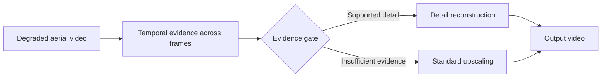

# Kestrel — Evidence-Gated Aerial Video Super-Resolution

M.Sc. thesis project by **Ayberk Saygı**, Çankaya University, 2023–2026.

## Problem

Aerial surveillance footage can be compressed, noisy and low-resolution. Super-resolution should recover detail supported by the input: plausible-looking textures that were never observed can mislead interpretation.

## Approach

Kestrel uses recurrent video processing and temporal evidence across neighbouring frames. An evidence gate permits supported detail reconstruction; where evidence is insufficient, the output falls back to standard upscaling.

## Reported evaluation results

On compressed, noisy aerial video, the evaluated system improved over bicubic upscaling by **+2.48 dB PSNR** and **38% lower LPIPS**. It performed on par with BasicVSR++ trained under the same conditions, with more stable output over time. These are results for the evaluated setup, rather than guarantees for arbitrary inputs.

## Research and deployment configurations

- **Research configuration:** ×4 training on Vimeo-90K; evaluation of fidelity, perceptual quality and temporal consistency. The streaming deployment design used a **24 FPS target**.
- **Lightweight deployment variant:** **14× smaller**, exportable to TensorRT; **26 FPS measured on one RTX 4090 for 720p → 1440p (×2)**.

The measured ×2 lightweight result and the ×4 research configuration are separate configurations. The 24 FPS target is a design target; 26 FPS is the reported lightweight measurement.

## Technology

Python · PyTorch · SpyNet optical flow · CUDA · FP16 · torch.compile · OpenCV · ONNX · TensorRT

## Scope and materials

This repository presents the research approach and reported results. Training code, model weights and datasets are not distributed here. Earlier research stages produced two journal articles that are under review, as reported in my 2026 CV.

## Author

[Ayberk Saygı on LinkedIn](https://www.linkedin.com/in/ayberk-s-0640811a4/) · [GitHub profile](https://github.com/rootroxox)
